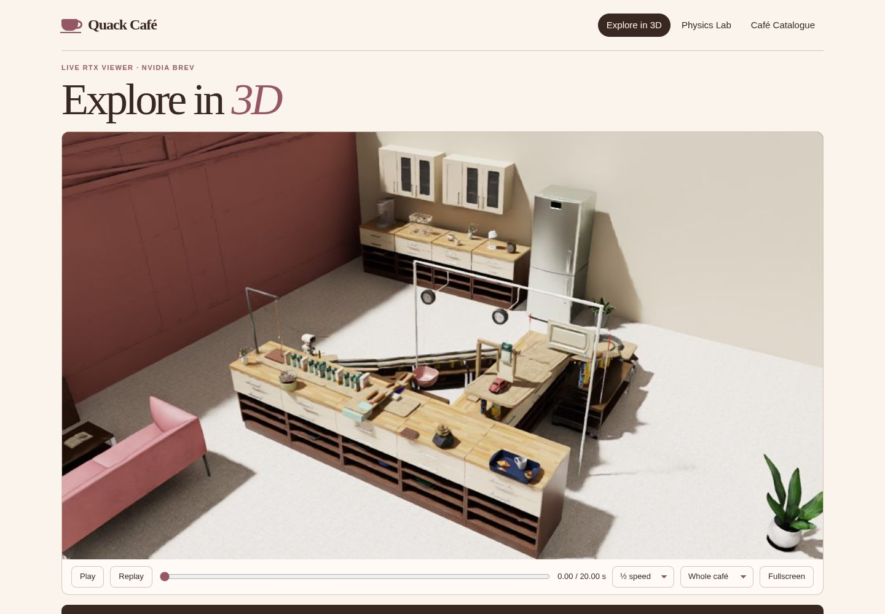
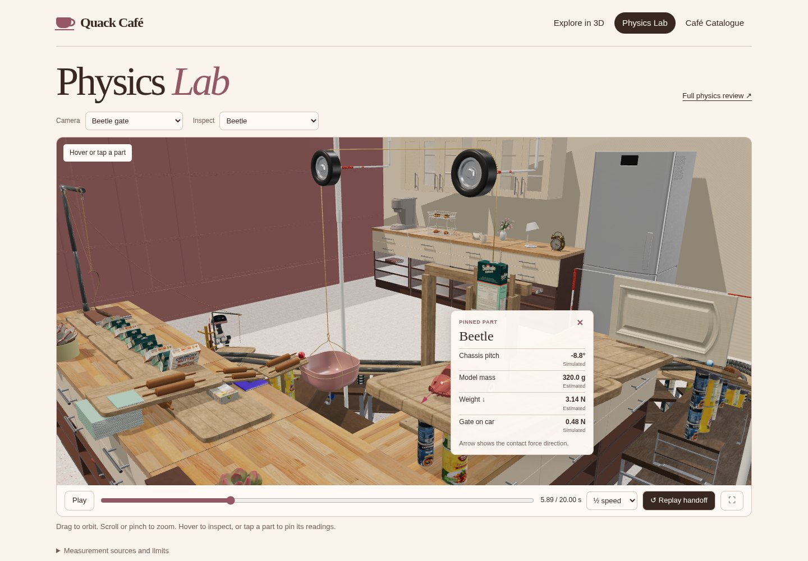
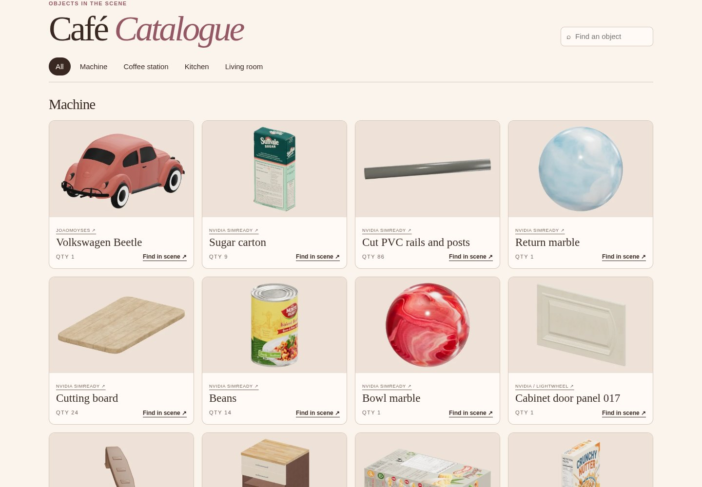

# Quack Café

Microduck built a kitchen-sized Rube Goldberg machine to drop one sugar cube into its coffee. Follow the ladle, cereal boxes, toy Beetle and marbles as each sets the next part in motion.

## Visit Quack Café

1. Open [Quack Café on NVIDIA Brev](https://brev.nvidia.com/launchable/deploy/now?launchableID=env-3LnkitsG2PiHFYuzQUKlP0T4s2Z) and sign in if prompted.
2. On the Launchable page, choose **Deploy**. Keep the default **NVIDIA L40S** GPU and confirm. Brev starts an instance for you and loads the café automatically.
3. When setup finishes, select **open-quack-cafe** endpoint on your deployment page. The website opens in **Explore in 3D**. On first use, the RTX renderer may take a few minutes to show the room.
4. Select **Play** to watch Microduck start the machine. Drag to orbit, scroll to zoom, or pause and scrub the timeline to see how one part triggers the next.

When you’re finished, return to the Brev Console and **stop your instance** to end the GPU session.

## Explore in 3D

Try the **Whole café** camera first to see the layout. Then switch to **Coffee mug** and replay the sugar drop from up close.

## Physics Lab

Open **Physics Lab** and choose **Beetle gate**. Hover over the car, or tap it to pin its readings, and replay the handoff to see what holds the Beetle before it rolls. **Marble bend** gives you an overhead view and a cross-section of the pipe guides.

## Café Catalogue

Search for an object such as a muffin, then select **Find in scene** to see where Microduck put it. Each entry includes a thumbnail, quantity and source.

The scene build, verified physics replay and RTX rendering ran on NVIDIA Brev using one NVIDIA L40S GPU.
